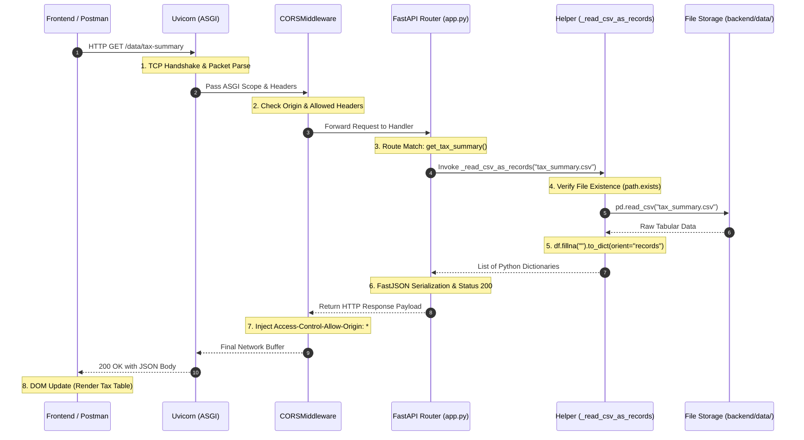

# 05. REST API Architecture & Endpoint Reference

> **Module Focus:** Complete API Specification, Endpoint Directory & Request Lifecycle  
> **Author & Mentor:** Senior Backend Developer & Technical Mentor  
> **Framework:** FastAPI (ASGI)

---

## 1. Master API Documentation Table

The CapTax AI backend exposes seven REST endpoints designed to orchestrate the pipeline and serve processed data to client applications:

| Endpoint | HTTP Method | Purpose | Request Parameters / Body | Response Payload Type | Status Codes |
|---|---|---|---|---|---|
| `/` | `GET` | Health check & endpoint discovery | None | `application/json` (Object) | `200 OK` |
| `/pipeline/run` | `POST` | Triggers sequential execution of all 7 pipeline stages | None | `application/json` (Step Log) | `200 OK`, `500 Internal Server Error` |
| `/data/trades` | `GET` | Retrieves all canonical normalized trades across brokers | None | `application/json` (Array of Trades) | `200 OK`, `404 Not Found` |
| `/data/realized-gains` | `GET` | Retrieves FIFO cost-basis matched trades with holding periods | None | `application/json` (Array of Gains) | `200 OK`, `404 Not Found` |
| `/data/tax-summary` | `GET` | Retrieves FY-wise capital gains tax calculations (Schedule CG) | None | `application/json` (Array of Tax Summaries) | `200 OK`, `404 Not Found` |
| `/data/dtaa-relief` | `GET` | Retrieves foreign dividend tax credit computations (Schedule FSI) | None | `application/json` (Array of DTAA Records) | `200 OK`, `404 Not Found` |
| `/data/disclosure-summary` | `GET` | Retrieves preformatted full text tax disclosure report | None | `application/json` (Report Object) | `200 OK`, `404 Not Found` |

---

## 2. Exhaustive Endpoint Specifications

### 2.1 Health Check & Discovery (`GET /`)
- **URL:** `http://localhost:8000/`
- **Method:** `GET`
- **Controller Function:** `root()` in `backend/app.py`
- **Headers:** None required.
- **Request Parameters / Body:** None.
- **Successful Response (`200 OK`):**
  ```json
  {
    "service": "CapTax AI API",
    "status": "ok",
    "endpoints": [
      "/pipeline/run",
      "/data/trades",
      "/data/tax-summary",
      "/data/dtaa-relief",
      "/data/disclosure-summary"
    ]
  }
  ```
- **Error Scenarios:** None.

---

### 2.2 Pipeline Orchestration (`POST /pipeline/run`)
- **URL:** `http://localhost:8000/pipeline/run`
- **Method:** `POST`
- **Controller Function:** `run_pipeline()` in `backend/app.py`
- **Headers:** `Content-Type: application/json`
- **Request Body:** None.
- **Operational Logic:** Iterates synchronously through the `PIPELINE` list, spawning child Python subprocesses for:
  1. `generate_datasets.py` (Anishka Jain)
  2. `ingest.py` (Anishka Jain)
  3. `corporate_actions_adjuster.py` (Anishka Jain)
  4. `fifo_matcher.py` (Anishka Jain)
  5. `tax_classifier.py` (Shraddha Singh)
  6. `dtaa_relief.py` (Shraddha Singh)
  7. `disclosure_generator.py` (Shraddha Singh)
- **Successful Response (`200 OK`):**
  ```json
  {
    "status": "completed",
    "steps": [
      {
        "step": "generate_datasets.py",
        "owner": "Anishka Jain",
        "status": "completed"
      },
      {
        "step": "ingest.py",
        "owner": "Anishka Jain",
        "status": "completed"
      },
      {
        "step": "corporate_actions_adjuster.py",
        "owner": "Anishka Jain",
        "status": "completed"
      },
      {
        "step": "fifo_matcher.py",
        "owner": "Anishka Jain",
        "status": "completed"
      },
      {
        "step": "tax_classifier.py",
        "owner": "Shraddha Singh",
        "status": "completed"
      },
      {
        "step": "dtaa_relief.py",
        "owner": "Shraddha Singh",
        "status": "completed"
      },
      {
        "step": "disclosure_generator.py",
        "owner": "Shraddha Singh",
        "status": "completed"
      }
    ]
  }
  ```
- **Error Response (`500 Internal Server Error`):**
  If any script crashes or returns a non-zero exit code:
  ```json
  {
    "detail": "tax_classifier.py failed:\nTraceback (most recent call last):\n  File ...\nFileNotFoundError: [Errno 2] No such file or directory: '...'"
  }
  ```

---

### 2.3 Normalized Trades (`GET /data/trades`)
- **URL:** `http://localhost:8000/data/trades`
- **Method:** `GET`
- **Controller Function:** `get_trades()` $\rightarrow$ `_read_csv_as_records("normalized_trades.csv")`
- **Successful Response (`200 OK`):**
  ```json
  [
    {
      "broker": "Zerodha",
      "symbol": "INFY",
      "company_name": "",
      "isin": "INE009A01021",
      "trade_date": "2023-05-14",
      "transaction_type": "BUY",
      "quantity": 50,
      "price": 1420.5,
      "price_currency": "INR",
      "fx_rate_to_inr": 1.0,
      "price_inr": 1420.5,
      "gross_amount_inr": 71025.0,
      "charges_inr": 92.33,
      "exchange": "NSE",
      "source_ref": "ZD100045"
    }
  ]
  ```
- **Error Response (`404 Not Found`):**
  ```json
  {
    "detail": "normalized_trades.csv not found — run /pipeline/run first"
  }
  ```

---

### 2.4 Realized Capital Gains (`GET /data/realized-gains`)
- **URL:** `http://localhost:8000/data/realized-gains`
- **Method:** `GET`
- **Controller Function:** `get_realized_gains()` $\rightarrow$ `_read_csv_as_records("realized_gains.csv")`
- **Successful Response (`200 OK`):**
  ```json
  [
    {
      "symbol": "TCS",
      "broker": "Groww",
      "buy_date": "2022-08-10",
      "sell_date": "2024-01-15",
      "quantity": 25,
      "buy_price": 3100.0,
      "sell_price": 3800.0,
      "cost_basis_inr": 77500.0,
      "sale_value_inr": 95000.0,
      "realized_gain_inr": 17500.0,
      "holding_period_days": 523,
      "flag": ""
    }
  ]
  ```
- **Error Response (`404 Not Found`):**
  ```json
  {
    "detail": "realized_gains.csv not found — run /pipeline/run first"
  }
  ```

---

### 2.5 Tax Summary for Schedule CG (`GET /data/tax-summary`)
- **URL:** `http://localhost:8000/data/tax-summary`
- **Method:** `GET`
- **Controller Function:** `get_tax_summary()` $\rightarrow$ `_read_csv_as_records("tax_summary.csv")`
- **Successful Response (`200 OK`):**
  ```json
  [
    {
      "financial_year": "FY2023-24",
      "ltcg_gain_inr": 210000.0,
      "stcg_gain_inr": 45000.0,
      "ltcg_exemption_applied_inr": 125000.0,
      "taxable_ltcg_inr": 85000.0,
      "ltcg_tax_inr": 10625.0,
      "stcg_tax_inr": 9000.0,
      "total_tax_inr": 19625.0
    }
  ]
  ```
- **Error Response (`404 Not Found`):**
  ```json
  {
    "detail": "tax_summary.csv not found — run /pipeline/run first"
  }
  ```

---

### 2.6 DTAA Relief for Schedule FSI (`GET /data/dtaa-relief`)
- **URL:** `http://localhost:8000/data/dtaa-relief`
- **Method:** `GET`
- **Controller Function:** `get_dtaa_relief()` $\rightarrow$ `_read_csv_as_records("dtaa_relief.csv")`
- **Successful Response (`200 OK`):**
  ```json
  [
    {
      "Security": "AAPL - Apple Inc",
      "financial_year": "FY2023-24",
      "Country of Source": "USA",
      "DTAA Article": "10(2)",
      "gross_dividend_inr": 12500.0,
      "foreign_tax_withheld_inr": 3125.0,
      "indian_tax_on_income_inr": 3750.0,
      "dtaa_relief_inr": 3125.0,
      "net_indian_tax_payable_inr": 625.0,
      "TDS Certificate Ref": "1042S-600012"
    }
  ]
  ```
- **Error Response (`404 Not Found`):**
  ```json
  {
    "detail": "dtaa_relief.csv not found — run /pipeline/run first"
  }
  ```

---

### 2.7 Disclosure Text Report (`GET /data/disclosure-summary`)
- **URL:** `http://localhost:8000/data/disclosure-summary`
- **Method:** `GET`
- **Controller Function:** `get_disclosure_summary()` in `backend/app.py`
- **Successful Response (`200 OK`):**
  ```json
  {
    "report": "======================================================================\nCapTax AI — Simplified Tax Disclosure Summary\n..."
  }
  ```
- **Error Response (`404 Not Found`):**
  ```json
  {
    "detail": "disclosure_summary.txt not found — run /pipeline/run first"
  }
  ```

---

## 3. The 8-Stage API Request-Response Lifecycle

Every time a client triggers an operation in CapTax AI, the request traverses an 8-stage lifecycle:



### Detailed Lifecycle Step Mapping to Source Code:
1. **Client Dispatches Request:** The browser dashboard executes `fetch("http://localhost:8000/data/tax-summary")` or user issues cURL command.
2. **Server Ingestion:** `uvicorn` listens on port 8000, receives HTTP request headers, and constructs an ASGI connection dictionary.
3. **CORS Middleware Evaluation:** `CORSMiddleware` (lines 28–33 of `app.py`) checks if the request origin matches allowed origins (`"*"`) and injects headers.
4. **Routing & Parameter Validation:** FastAPI router matches the route `/data/tax-summary` and method `GET` to the function `get_tax_summary()` (lines 97–98).
5. **Business Logic Execution:** `get_tax_summary()` delegates to `_read_csv_as_records("tax_summary.csv")` (lines 60–65).
6. **Data Retrieval:** `DATA_DIR / "tax_summary.csv"` is queried. If missing, `HTTPException(status_code=404)` is thrown immediately. If present, `pd.read_csv()` reads the file into memory.
7. **Serialization & Sanitization:** `.fillna("")` replaces NaN values with empty strings, and `.to_dict(orient="records")` transforms the tabular rows into native Python JSON-compatible dictionaries.
8. **Client Response Transmission:** FastAPI packages the dictionaries into a JSON string with a `200 OK` header, passes it through Uvicorn, and sends it across the wire to the client.
