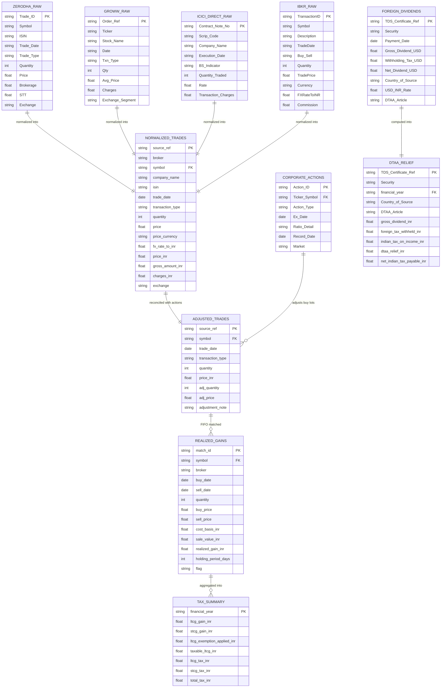

# 06. Data Persistence, Schemas & Entity-Relationship Architecture

> **Module Focus:** Data Storage, Canonical Schemas, and Conceptual Database Design  
> **Author & Mentor:** Senior Backend Developer & Technical Mentor  
> **Current Paradigm:** Tabular Flat-File CSV Persistence (Pandas)  
> **Planned Paradigm:** PostgreSQL Relational Database (SQLAlchemy / Alembic)

---

## 1. Current Storage Paradigm: Flat-File CSV Architecture

In this Round 2 academic prototype, the database is implemented as a **structured flat-file storage system** managed by Pandas inside `backend/data/`.

### Why Flat Files for Round 2?
1. **Zero-Configuration Portability:** Eliminates the need for team members, evaluators, or viva examiners to install, configure, and seed a local PostgreSQL or MySQL server.
2. **Deterministic Reproducibility:** `generate_datasets.py` writes deterministic CSV files that can be inspected directly in Excel, VS Code, or plain text editors.
3. **Audit Trail Transparency:** Each stage of the pipeline writes a distinct, immutable snapshot to disk (`normalized_trades.csv` $\rightarrow$ `adjusted_trades.csv` $\rightarrow$ `realized_gains.csv`), enabling step-by-step auditing.

---

## 2. Comprehensive Entity-Relationship (ER) Diagram

The following Mermaid ER Diagram models the complete data flow, from disparate broker ingestion to final ITR schedules:



---

## 3. Data Dictionary: Core Canonical Schemas

### 3.1 The Canonical Trade Schema (`normalized_trades.csv`)
Produced by `ingest.py`, this table standardizes all domestic and international broker exports into a 15-column specification:

| Field Name | Type | Nullable | Description & Domain Rules |
|---|---|---|---|
| `broker` | `VARCHAR(32)` | No | Name of broker (`"Zerodha"`, `"Groww"`, `"ICICI Direct"`, `"Interactive Brokers"`). |
| `symbol` | `VARCHAR(16)` | No | Equity ticker symbol (`"RELIANCE"`, `"INFY"`, `"AAPL"`, `"MSFT"`). |
| `company_name` | `VARCHAR(128)`| Yes | Formal registered entity name (populated when available; else `NaN`). |
| `isin` | `VARCHAR(12)` | Yes | 12-character International Securities Identification Number. |
| `trade_date` | `DATE` | No | Standardized ISO date of execution (`YYYY-MM-DD`). |
| `transaction_type` | `VARCHAR(4)` | No | Execution direction: strictly `'BUY'` or `'SELL'`. |
| `quantity` | `INTEGER` | No | Number of shares transacted (strictly $> 0$). |
| `price` | `FLOAT` | No | Per-share price in the asset's native trading currency. |
| `price_currency` | `VARCHAR(3)` | No | Three-letter ISO currency code (`"INR"` or `"USD"`). |
| `fx_rate_to_inr` | `FLOAT` | No | Conversion multiplier to Indian Rupee (1.0 for INR; 78.0–87.0 for USD). |
| `price_inr` | `FLOAT` | No | Native price multiplied by FX rate: $\text{price} \times \text{fx\_rate\_to\_inr}$. |
| `gross_amount_inr`| `FLOAT` | No | Total trade turnover: $\text{price\_inr} \times \text{quantity}$. |
| `charges_inr` | `FLOAT` | No | Total statutory levies and broker fees converted to INR. |
| `exchange` | `VARCHAR(16)` | No | Stock exchange (`"NSE"`, `"BSE"`, `"NASDAQ"`, `"NYSE"`). |
| `source_ref` | `VARCHAR(64)` | No | Original audit identifier from the broker contract note/statement. |

---

### 3.2 Corporate Action Reconciled Schema (`adjusted_trades.csv`)
Produced by `corporate_actions_adjuster.py`, adding 3 reconciliation columns:

| Field Name | Type | Description |
|---|---|---|
| `adj_quantity` | `INTEGER` | Diluted/inflated share quantity after applying splits/bonuses. |
| `adj_price` | `FLOAT` | Adjusted cost basis per share (preserving total investment value). |
| `adjustment_note`| `VARCHAR(255)`| Audit trail detailing corporate actions applied (e.g., `"Bonus issue 1:1 on 2023-05-15;"`). |

---

### 3.3 FIFO Matched Realized Gains Schema (`realized_gains.csv`)
Produced by `fifo_matcher.py`, representing the tax event triggered by every sale:

| Field Name | Type | Description |
|---|---|---|
| `symbol` | `VARCHAR(16)` | Stock ticker. |
| `broker` | `VARCHAR(32)` | Broker facilitating the sale. |
| `buy_date` | `DATE` | Date the matched BUY lot was originally executed. |
| `sell_date` | `DATE` | Date of the SELL execution. |
| `quantity` | `INTEGER` | Number of shares matched in this specific lot tranche. |
| `buy_price` | `FLOAT` | Acquisition price per share in INR. |
| `sell_price` | `FLOAT` | Disposal price per share in INR. |
| `cost_basis_inr` | `FLOAT` | $\text{quantity} \times \text{buy\_price}$. |
| `sale_value_inr` | `FLOAT` | $\text{quantity} \times \text{sell\_price}$. |
| `realized_gain_inr`| `FLOAT` | Realized profit or loss: $\text{sale\_value\_inr} - \text{cost\_basis\_inr}$. |
| `holding_period_days`| `INTEGER` | Calendar duration: $(\text{sell\_date} - \text{buy\_date}).\text{days}$. |
| `flag` | `VARCHAR(32)` | Exception flag (e.g., `'UNMATCHED_SELL_QUANTITY'` if sold without buy lot). |

---

## 4. Database CRUD Operations in the Current Engine

Because the system uses Pandas and CSVs, standard CRUD operations map directly to tabular file operations:

| CRUD Operation | Code Location | Implementation Method |
|---|---|---|
| **Create (Insert)** | `generate_datasets.py`, `ingest.py` | `df.to_csv(filepath, index=False)` creates fresh CSV records. |
| **Read (Select)** | `ingest.py`, `app.py`, `fifo_matcher.py` | `pd.read_csv(filepath)` loads data from disk into memory. |
| **Update (Modify)**| `corporate_actions_adjuster.py` | `trades.loc[mask, "adj_price"] = trades.loc[mask, "adj_price"] / multiplier` |
| **Delete (Remove)**| `fifo_matcher.py` | `lots.popleft()` purges depleted BUY lots from the in-memory queue. |

---

## 5. Production Transition Roadmap: PostgreSQL Relational DDL

To advance CapTax AI to a production-grade enterprise platform (planned for Round 3 / post-prototype), the flat files must be migrated to a relational PostgreSQL database. Here is the exact SQL DDL schema designed to replace the flat files:

```sql
-- Enums for constrained domains
CREATE TYPE transaction_side AS ENUM ('BUY', 'SELL');
CREATE TYPE corporate_action_type AS ENUM ('Split', 'Bonus', 'Dividend', 'Rights');
CREATE TYPE gain_category AS ENUM ('STCG', 'LTCG');

-- Master Users Table
CREATE TABLE users (
    user_id UUID PRIMARY KEY DEFAULT gen_random_uuid(),
    email VARCHAR(255) UNIQUE NOT NULL,
    hashed_password VARCHAR(255) NOT NULL,
    full_name VARCHAR(128) NOT NULL,
    pan_number VARCHAR(10) UNIQUE,
    created_at TIMESTAMP WITH TIME ZONE DEFAULT CURRENT_TIMESTAMP
);

-- Master Securities / Ticker Catalog
CREATE TABLE securities (
    symbol VARCHAR(16) PRIMARY KEY,
    isin VARCHAR(12) UNIQUE,
    company_name VARCHAR(255) NOT NULL,
    market VARCHAR(16) NOT NULL, -- 'NSE', 'BSE', 'NASDAQ', 'NYSE'
    currency VARCHAR(3) NOT NULL DEFAULT 'INR'
);

-- Normalized Trades Table
CREATE TABLE trades (
    trade_id UUID PRIMARY KEY DEFAULT gen_random_uuid(),
    user_id UUID REFERENCES users(user_id) ON DELETE CASCADE,
    broker VARCHAR(32) NOT NULL,
    symbol VARCHAR(16) REFERENCES securities(symbol),
    trade_date DATE NOT NULL,
    transaction_type transaction_side NOT NULL,
    quantity INTEGER NOT NULL CHECK (quantity > 0),
    price NUMERIC(14, 4) NOT NULL CHECK (price > 0),
    price_currency VARCHAR(3) NOT NULL DEFAULT 'INR',
    fx_rate_to_inr NUMERIC(10, 4) NOT NULL DEFAULT 1.0,
    price_inr NUMERIC(14, 4) NOT NULL,
    gross_amount_inr NUMERIC(14, 4) NOT NULL,
    charges_inr NUMERIC(10, 4) NOT NULL DEFAULT 0.0,
    exchange VARCHAR(16) NOT NULL,
    source_ref VARCHAR(64) NOT NULL,
    created_at TIMESTAMP WITH TIME ZONE DEFAULT CURRENT_TIMESTAMP
);

-- Corporate Actions Table
CREATE TABLE corporate_actions (
    action_id UUID PRIMARY KEY DEFAULT gen_random_uuid(),
    symbol VARCHAR(16) REFERENCES securities(symbol),
    action_type corporate_action_type NOT NULL,
    ex_date DATE NOT NULL,
    record_date DATE,
    ratio_detail VARCHAR(32) NOT NULL,
    multiplier NUMERIC(8, 4) NOT NULL
);

-- Realized Gains (FIFO Matched Ledger)
CREATE TABLE realized_gains (
    match_id UUID PRIMARY KEY DEFAULT gen_random_uuid(),
    user_id UUID REFERENCES users(user_id) ON DELETE CASCADE,
    symbol VARCHAR(16) REFERENCES securities(symbol),
    broker VARCHAR(32) NOT NULL,
    buy_date DATE NOT NULL,
    sell_date DATE NOT NULL,
    quantity INTEGER NOT NULL,
    buy_price_inr NUMERIC(14, 4) NOT NULL,
    sell_price_inr NUMERIC(14, 4) NOT NULL,
    cost_basis_inr NUMERIC(14, 4) NOT NULL,
    sale_value_inr NUMERIC(14, 4) NOT NULL,
    realized_gain_inr NUMERIC(14, 4) NOT NULL,
    holding_period_days INTEGER NOT NULL,
    gain_type gain_category NOT NULL,
    financial_year VARCHAR(10) NOT NULL
);

-- Indexes for performance
CREATE INDEX idx_trades_user_symbol ON trades(user_id, symbol, trade_date);
CREATE INDEX idx_gains_user_fy ON realized_gains(user_id, financial_year);
```
