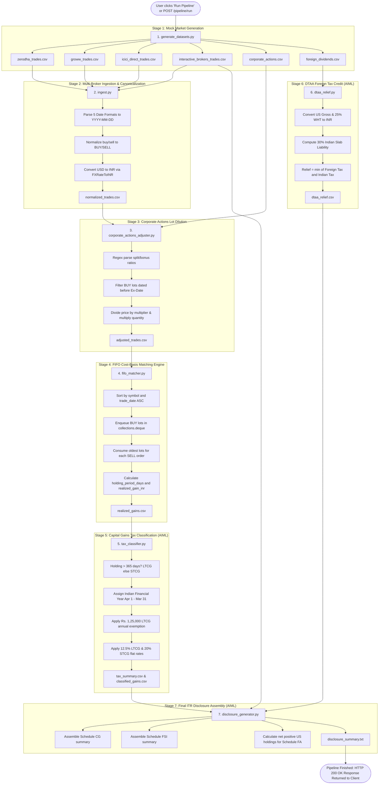

# 07. Backend Business Logic & Pipeline Workflow

> **Module Focus:** Complete End-to-End Business Logic & Algorithmic Execution Sequences  
> **Author & Mentor:** Senior Backend Developer & Technical Mentor  
> **Key Domains:** Multi-Broker Ingestion, Stock Dilution, FIFO Matching & Tax Synthesis

---

## 1. End-to-End Pipeline Workflow Diagram

The diagram below details the exact chronological sequence of data transformations occurring across the backend and AI/ML layers when `/pipeline/run` is called:

---

## 2. In-Depth Breakdown of Each Business Logic Stage

### Stage 1: Synthetic Dataset Generation (`generate_datasets.py`)
- **Owner:** Anishka Jain (Backend Lead)
- **Execution Trigger:** Step 1 of `POST /pipeline/run` or standalone `python generate_datasets.py`.
- **Input:** Hardcoded master ticker lists (`INDIAN_STOCKS`, `US_STOCKS`) and random seeds.
- **Output:** 6 CSV files created in `./data/`:
  1. `zerodha_trades.csv` (180 rows)
  2. `groww_trades.csv` (150 rows)
  3. `icici_direct_trades.csv` (120 rows)
  4. `interactive_brokers_trades.csv` (90 rows)
  5. `corporate_actions.csv` (25 rows)
  6. `foreign_dividends.csv` (40 rows)
- **Business Purpose:** Mimics the fragmentation of the real financial world, embedding varied date representations, mixed casing, and currency exchange rates.

---

### Stage 2: Ingestion & Canonical Normalization (`ingest.py`)
- **Owner:** Anishka Jain (Backend Lead)
- **Main Functions:** `normalize_all()`, `_std_side()`, `validate()`, and 4 loader functions.
- **Input:** The 4 broker trade CSV files from `./data/`.
- **Transformation Sequence:**
  1. Iterates through loaders (`load_zerodha`, `load_groww`, `load_icici_direct`, `load_interactive_brokers`).
  2. Parses dates into ISO standard:
     - Zerodha: `%Y-%m-%d` $\rightarrow$ `2023-04-15`
     - Groww: `%d/%m/%Y` $\rightarrow$ `15/04/2023` $\rightarrow$ `2023-04-15`
     - ICICI: `%d-%b-%Y` $\rightarrow$ `15-Apr-2023` $\rightarrow$ `2023-04-15`
     - IBKR: `%Y%m%d` $\rightarrow$ `20230415` $\rightarrow$ `2023-04-15`
  3. Directional standardization: `_std_side()` translates all variations (`"B"`, `"buy"`, `"BUY"`) into `"BUY"`.
  4. Currency conversion: Foreign amounts (IBKR in USD) are multiplied by `FXRateToINR`. Brokerage fees in USD are also converted to INR.
  5. Computes `gross_amount_inr = round(price_inr * quantity, 2)`.
  6. Enforces validation assertions (all prices $> 0$, all quantities $> 0$).
- **Output:** `./data/normalized_trades.csv` (540 consolidated rows).

---

### Stage 3: Corporate Action Adjustment (`corporate_actions_adjuster.py`)
- **Owner:** Anishka Jain (Backend Lead)
- **Main Functions:** `apply_adjustments()`, `parse_ratio()`, `load_actions()`.
- **Input:** `./data/normalized_trades.csv` and `./data/corporate_actions.csv`.
- **Business Logic & Mathematical Dilution:**
  - When a stock split or bonus issue occurs, the physical number of shares changes on the **Ex-Date**, but the economic value remains identical.
  - Regex extracts ratios:
    - `"Stock split 1:2"` $\rightarrow \text{multiplier} = \frac{2}{1} = 2.0$.
    - `"Bonus issue 1:1"` $\rightarrow \text{multiplier} = \frac{1+1}{1} = 2.0$.
  - The module selects BUY lots where `symbol == action_symbol` and `trade_date < ex_date`.
  - Dilution formula:
    $$\text{adj\_quantity} = \text{round}(\text{quantity} \times \text{multiplier})$$
    $$\text{adj\_price} = \frac{\text{price\_inr}}{\text{multiplier}}$$
- **Output:** `./data/adjusted_trades.csv`.

---

### Stage 4: FIFO Cost-Basis Matching (`fifo_matcher.py`)
- **Owner:** Anishka Jain (Backend Lead)
- **Main Functions:** `fifo_match()`.
- **Input:** `./data/adjusted_trades.csv`.
- **Core Algorithm:**
  1. Groups all trades by `symbol` and sorts chronologically.
  2. Maintains a queue of BUY lots (`collections.deque`) per symbol.
  3. When a `SELL` is processed:
     - Extracts the oldest buy lot from `lots[0]`.
     - Matched quantity: $\min(\text{sell\_qty}, \text{lot\_qty})$.
     - Calculates holding period:
       $$\text{holding\_period\_days} = (\text{sell\_date} - \text{buy\_date}).\text{days}$$
     - Calculates financial gain:
       $$\text{cost\_basis} = \text{matched\_qty} \times \text{buy\_price}$$
       $$\text{sale\_value} = \text{matched\_qty} \times \text{sell\_price}$$
       $$\text{realized\_gain} = \text{sale\_value} - \text{cost\_basis}$$
     - If the lot is exhausted, calls `lots.popleft()`.
     - If `sell_qty` exceeds all available buy lots, creates an audit record flagged with `"UNMATCHED_SELL_QUANTITY"`.
- **Output:** `./data/realized_gains.csv`.

---

### Stage 5: Capital Gains Tax Classification (`tax_classifier.py`)
- **Owner:** Shraddha Singh (Lead & AI/Interpretation Lead)
- **Input:** `./data/realized_gains.csv`.
- **Rules Applied (Indian Income Tax Act - Budget 2024 Regime):**
  - **Holding Period Threshold:**
    $$\text{gain\_type} = \begin{cases} \text{LTCG} & \text{if holding\_period\_days} > 365 \\ \text{STCG} & \text{otherwise} \end{cases}$$
  - **Financial Year Grouping:** April 1 to March 31.
  - **Annual LTCG Exemption:** ₹1,25,000 deducted from aggregate annual LTCG gains.
  - **Tax Rates:**
    - Taxable LTCG taxed at flat **12.5%**.
    - STCG taxed at flat **20.0%**.
- **Output:** `./data/classified_gains.csv` and `./data/tax_summary.csv`.

---

### Stage 6: Foreign Tax Credit / DTAA Relief (`dtaa_relief.py`)
- **Owner:** Shraddha Singh (Lead & AI/Interpretation Lead)
- **Input:** `./data/foreign_dividends.csv`.
- **Rules Applied (Section 90 & Article 25 India-US Treaty):**
  - Indian tax resident pays tax on global dividend income at their marginal slab rate (modeled as 30%).
  - The US has already deducted 25% withholding tax at source (Form 1042-S).
  - Relief formula:
    $$\text{dtaa\_relief\_inr} = \min(\text{foreign\_tax\_withheld\_inr}, \text{indian\_tax\_on\_income\_inr})$$
    $$\text{net\_indian\_tax\_payable\_inr} = \text{indian\_tax\_on\_income\_inr} - \text{dtaa\_relief\_inr}$$
- **Output:** `./data/dtaa_relief.csv`.

---

### Stage 7: Final Disclosure Synthesis (`disclosure_generator.py`)
- **Owner:** Shraddha Singh (Lead & AI/Interpretation Lead)
- **Input:** `tax_summary.csv`, `dtaa_relief.csv`, `interactive_brokers_trades.csv`.
- **Behavior:**
  - Calculates net open positions in US stocks to approximate Schedule FA (Foreign Assets) reporting.
  - Aggregates capital gains by FY for Schedule CG.
  - Formats dividend tax relief for Schedule FSI.
  - Assembles a clean, human-readable ASCII text summary.
- **Output:** `./data/disclosure_summary.txt`.
