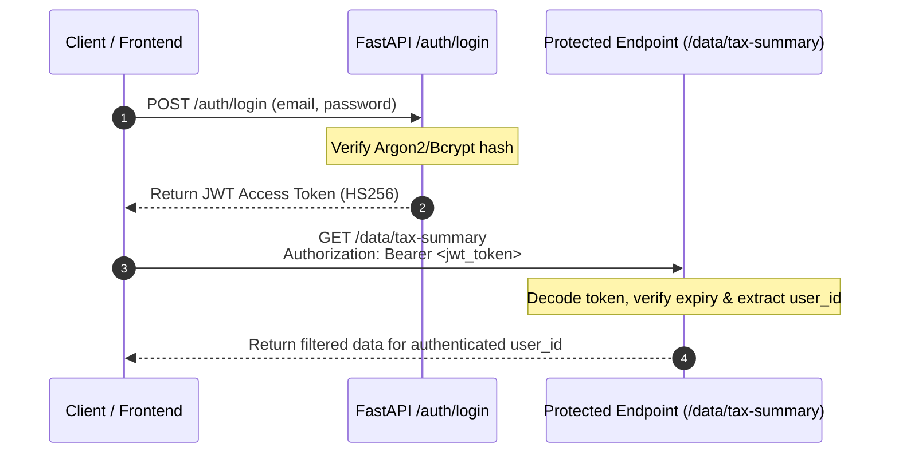

# 08. Authentication, Authorization & Backend Security Audit

> **Module Focus:** Complete Security Posture, Vulnerability Audit & Production Hardening  
> **Author & Mentor:** Senior Backend Developer & Technical Mentor  
> **Current Status:** Academic Prototype (Open / Zero Authentication)  
> **Target Status:** Hardened Enterprise Financial Microservice

---

## 1. Security Implementation Status Audit

In compliance with strict analytical guidelines, here is the exact, unvarnished state of security features in the `CapTax AI` backend codebase:

| Security Domain | Current Codebase Implementation | Present in Files | Vulnerability Rating |
|---|---|---|---|
| **User Registration** | **Not Implemented** | None | N/A (Prototype) |
| **Login / Logout** | **Not Implemented** | None | N/A (Prototype) |
| **Password Hashing** | **Not Implemented** | None | N/A (Prototype) |
| **JWT Authentication** | **Not Implemented** | None | High Risk |
| **Session Management** | **Not Implemented** | None | N/A |
| **Role-Based Access (RBAC)**| **Not Implemented** | None | High Risk |
| **API Key Validation** | **Not Implemented** | None | High Risk |
| **Input Sanitization** | Basic Pandas typecasting & assertions (`ingest.py`) | `ingest.py` | Medium Risk |
| **CORS Policy** | **Wildcard Enabled** (`allow_origins=["*"]`) | `app.py` (line 30) | Medium Risk |
| **Rate Limiting** | **Not Implemented** | None | Critical Risk |
| **Error Handling / Leaks** | **Internal Tracebacks Leaked** | `app.py` (line 56) | High Risk |
| **Secrets Management** | No API keys or tokens currently stored | None | Low Risk |

---

## 2. In-Depth Vulnerability Assessment & Technical Risks

### Vulnerability 1: Denial of Service (DoS) via `/pipeline/run`
- **Location:** `backend/app.py`, lines 76–84 (`@app.post("/pipeline/run")`)
- **Mechanism:** The `/pipeline/run` endpoint requires no authentication and executes synchronously on the main thread via `subprocess.run`. A single malicious actor or automated bot could dispatch 100 concurrent POST requests, spawning hundreds of parallel Python processes.
- **Impact:** Immediate CPU saturation, memory exhaustion, and complete server freeze (Denial of Service).

---

### Vulnerability 2: Sensitive System Information Disclosure in Error Details
- **Location:** `backend/app.py`, lines 53–57:
  ```python
  if result.returncode != 0:
      raise HTTPException(
          status_code=500,
          detail=f"{script_path.name} failed:\n{result.stdout}\n{result.stderr}",
      )
  ```
- **Mechanism:** When a script encounters an error, the raw `stdout` and `stderr` buffers are directly injected into the HTTP 500 response payload sent back to the browser client.
- **Impact:** Exposes absolute Windows/Linux file paths, directory layouts, environment variables, Python versions, and internal software stack traces to unauthorized public users.

---

### Vulnerability 3: Insecure Cross-Origin Resource Sharing (Wildcard CORS)
- **Location:** `backend/app.py`, lines 28–33:
  ```python
  app.add_middleware(
      CORSMiddleware,
      allow_origins=["*"],
      allow_methods=["*"],
      allow_headers=["*"],
  )
  ```
- **Mechanism:** Using `allow_origins=["*"]` allows any website on the internet running in a victim's browser to make requests to `http://localhost:8000` and read confidential financial data (such as trade quantities, realized capital gains, and dividend tax information).
- **Impact:** Cross-Site Information Leakage and Cross-Site Request Forgery (CSRF).

---

### Vulnerability 4: Absence of Authentication & Data Isolation
- **Location:** All endpoints under `/data/*` in `backend/app.py`.
- **Mechanism:** There is no multi-tenancy or user identification. The API serves a single shared set of CSV files stored on the local server disk.
- **Impact:** User A can view or trigger pipeline calculations that overwrite User B's financial data.

---

## 3. Production Security Hardening Blueprint

To make this backend enterprise-grade and interview-ready, the following architectural fixes are recommended (without modifying original prototype files):

### 3.1 Recommended JWT Authentication Architecture



### 3.2 Concrete Code Blueprint for JWT Security

Here is the exact code pattern recommended for Round 3 implementation:

```python
# proposed_security.py (Recommended implementation)
from datetime import datetime, timedelta, timezone
from fastapi import Depends, HTTPException, status
from fastapi.security import OAuth2PasswordBearer
import jwt
from passlib.context import CryptContext
from pydantic import BaseModel

SECRET_KEY = "ENFORCE_STRONG_SECRET_FROM_ENV"
ALGORITHM = "HS256"
ACCESS_TOKEN_EXPIRE_MINUTES = 60

pwd_context = CryptContext(schemes=["bcrypt"], deprecated="auto")
oauth2_scheme = OAuth2PasswordBearer(tokenUrl="auth/token")

class TokenData(BaseModel):
    user_id: str
    email: str

def verify_password(plain_password: str, hashed_password: str) -> bool:
    return pwd_context.verify(plain_password, hashed_password)

def create_access_token(data: dict) -> str:
    to_encode = data.copy()
    expire = datetime.now(timezone.utc) + timedelta(minutes=ACCESS_TOKEN_EXPIRE_MINUTES)
    to_encode.update({"exp": expire})
    return jwt.encode(to_encode, SECRET_KEY, algorithm=ALGORITHM)

async def get_current_user(token: str = Depends(oauth2_scheme)) -> TokenData:
    credentials_exception = HTTPException(
        status_code=status.HTTP_401_UNAUTHORIZED,
        detail="Could not validate credentials",
        headers={"WWW-Authenticate": "Bearer"},
    )
    try:
        payload = jwt.decode(token, SECRET_KEY, algorithms=[ALGORITHM])
        user_id: str = payload.get("sub")
        email: str = payload.get("email")
        if user_id is None or email is None:
            raise credentials_exception
        return TokenData(user_id=user_id, email=email)
    except jwt.PyJWTError:
        raise credentials_exception
```

### 3.3 Production CORS Hardening
Replace wildcard origins with explicit environment-driven origins:
```python
# Hardened CORS configuration
ORIGINS = [
    "http://localhost:3000",       # React frontend development
    "http://127.0.0.1:5500",       # VS Code Live Server
    "https://captax.yourdomain.com" # Production domain
]

app.add_middleware(
    CORSMiddleware,
    allow_origins=ORIGINS,
    allow_credentials=True,
    allow_methods=["GET", "POST"],
    allow_headers=["Authorization", "Content-Type"],
)
```

### 3.4 Production Error Sanitization
Never expose raw tracebacks to clients; log internally and return opaque error IDs:
```python
import logging
import uuid

logger = logging.getLogger("captax.backend")

def _run_script_hardened(script_path: Path) -> None:
    result = subprocess.run(
        [sys.executable, str(script_path)],
        cwd=script_path.parent,
        capture_output=True,
        text=True,
    )
    if result.returncode != 0:
        error_ref = str(uuid.uuid4())
        logger.error(f"Error {error_ref} in {script_path.name}:\n{result.stderr}")
        raise HTTPException(
            status_code=500,
            detail=f"An internal error occurred during {script_path.name}. Reference ID: {error_ref}",
        )
```
