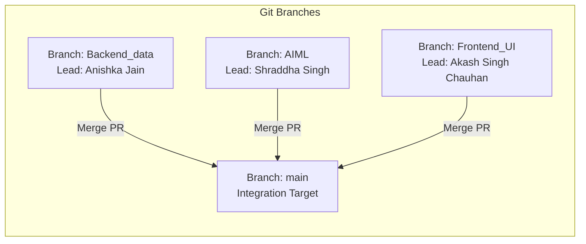

# 09. Multi-Branch & Cross-Module Integration Architecture

> **Module Focus:** System Interoperability Across Git Branches (`main`, `AIML`, `Backend_data`, `Frontend_UI`)  
> **Author & Mentor:** Senior Backend Developer & Technical Mentor  
> **Key Domains:** Data Contracts, Filesystem Inter-Process Communication & Branch Merging

---

## 1. Cross-Branch Repository Layout & Team Division

The CapTax AI repository was developed in parallel across four primary Git branches, each assigned to a specific engineering role:



In your current local workspace, these branches have been extracted into sibling folders side by side:
- `D:\CapTax-AI\Backend_data`
- `D:\CapTax-AI\AIML`
- `D:\CapTax-AI\Frontend_UI`
- `D:\CapTax-AI\main`

---

## 2. Cross-Module Communication Protocols

The three active tiers communicate via two distinct communication protocols:

```mermaid
graph TD
    subgraph Frontend Tier ["Frontend Tier (Frontend_UI/frontend/index.html)"]
        UI[Akash Singh Chauhan<br/>Vanilla JS / HTML5 Dashboard]
    end

    subgraph Backend Gateway ["Backend Gateway (Backend_data/backend/app.py)"]
        API[Anishka Jain<br/>FastAPI Server :8000]
    end

    subgraph Backend Core ["Backend Core Processing (Backend_data/backend/)"]
        GEN[generate_datasets.py]
        ING[ingest.py]
        ADJ[corporate_actions_adjuster.py]
        FIFO[fifo_matcher.py]
    end

    subgraph AIML Tier ["AI/ML Compliance Tier (AIML/aiml/)"]
        TAX[tax_classifier.py]
        DTAA[dtaa_relief.py]
        DISC[disclosure_generator.py]
    end

    subgraph Shared Storage ["Data Contract Store (backend/data/*.csv)"]
        STORE[(CSV Data Files on Disk)]
    end

    %% Network Protocol
    UI -->|1. HTTP REST JSON<br/>POST /pipeline/run<br/>GET /data/*| API

    %% Process Protocol
    API -->|2. OS Subprocess Spawn<br/>sys.executable| Backend Core
    API -->|3. OS Subprocess Spawn<br/>sys.executable| AIML Tier

    %% File System IPC
    Backend Core -->|Writes normalized, adjusted & realized CSVs| STORE
    AIML Tier -->|Reads realized & dividend CSVs<br/>Writes tax & disclosure summaries| STORE
    STORE -->|4. Read into DataFrames for JSON serialization| API
```

### Protocol 1: Client-to-Backend (HTTP REST over JSON)
- **Initiator:** Frontend Dashboard (`Frontend_UI/frontend/index.html`).
- **Receiver:** FastAPI Server (`Backend_data/backend/app.py`).
- **Transport:** HTTP / JSON over TCP port 8000.
- **Payloads:** JSON-serialized dictionaries produced from Pandas DataFrames via `.to_dict(orient="records")`.

### Protocol 2: Backend-to-AIML (Filesystem IPC & Process Spawning)
- **Initiator:** FastAPI Server (`_run_script()` in `app.py`).
- **Receiver:** Standalone Python scripts in `AIML/aiml/`.
- **Transport:** Standard OS Process execution via `subprocess.run()`.
- **Data Exchange Mechanism:** Shared flat-file CSV files stored on the local filesystem (`backend/data/`).

---

## 3. Frontend-to-Backend Integration Contract

The frontend dashboard (`Frontend_UI/frontend/index.html`) is designed to consume specific backend endpoints:

| Frontend UI Component | Expected Backend API Endpoint | HTTP Method | Expected Payload Contract | Status in Codebase |
|---|---|---|---|---|
| **Run Pipeline Button** | `/pipeline/run` | `POST` | `{"status": "completed", "steps": [...]}` | **Fully Integrated** |
| **Tax Summary Card** | `/data/tax-summary` | `GET` | Array of objects with `financial_year`, `ltcg_gain_inr`, `taxable_ltcg_inr`, etc. | **Fully Integrated** |
| **DTAA Relief Card** | `/data/dtaa-relief` | `GET` | Array of objects with `Security`, `gross_dividend_inr`, `dtaa_relief_inr`, etc. | **Fully Integrated** |
| **Disclosure Report Card** | `/data/disclosure-summary` | `GET` | Object containing `{"report": "..."}` | **Fully Integrated** |
| *Trade Inspector (Future)*| `/data/trades` | `GET` | Array of canonical trades | Endpoint exists on Backend; UI not yet built |
| *Gain Inspector (Future)* | `/data/realized-gains` | `GET` | Array of matched lots | Endpoint exists on Backend; UI not yet built |

---

## 4. Backend-to-AIML Integration & Data Contracts

The backend and AI/ML tiers interact strictly through disk-persisted data contracts:

### Contract 1: Realized Gains $\rightarrow$ Tax Classifier
- **Producer:** `fifo_matcher.py` (Backend)
- **Consumer:** `tax_classifier.py` (AIML)
- **File:** `backend/data/realized_gains.csv`
- **Contract Schema:** `symbol`, `broker`, `buy_date`, `sell_date`, `quantity`, `buy_price`, `sell_price`, `cost_basis_inr`, `sale_value_inr`, `realized_gain_inr`, `holding_period_days`.
- **Compliance:** `tax_classifier.py` reads `holding_period_days` to determine whether the record qualifies as LTCG ($> 365$ days) or STCG ($\le 365$ days).

### Contract 2: Foreign Dividends $\rightarrow$ DTAA Relief
- **Producer:** `generate_datasets.py` (Backend)
- **Consumer:** `dtaa_relief.py` (AIML)
- **File:** `backend/data/foreign_dividends.csv`
- **Contract Schema:** `Security`, `Payment Date`, `Gross Dividend (USD)`, `Withholding Tax (USD)`, `USD-INR Rate`, `DTAA Article`, `TDS Certificate Ref`.
- **Compliance:** `dtaa_relief.py` computes Section 90 foreign tax relief by multiplying USD amounts by the FX rate and comparing foreign tax withheld against Indian liability.

### Contract 3: Summaries $\rightarrow$ Final Disclosure Generator
- **Producers:** `tax_classifier.py` (AIML), `dtaa_relief.py` (AIML), and `generate_datasets.py` (Backend).
- **Consumer:** `disclosure_generator.py` (AIML).
- **Files:** `tax_summary.csv`, `dtaa_relief.csv`, `interactive_brokers_trades.csv`.
- **Output:** `disclosure_summary.txt`.

---

## 5. Critical Integration Flaw: The Cross-Branch Path Mismatch

A vital discovery from inspecting the multi-branch structure is a **path resolution breakdown** when attempting to run the system across separated branch folders:

### The Problem in `Backend_data/backend/app.py`:
Lines 20–22 state:
```python
BACKEND_DIR = Path(__file__).resolve().parent      # D:\CapTax-AI\Backend_data\backend
PROJECT_DIR = BACKEND_DIR.parent                   # D:\CapTax-AI\Backend_data
AIML_DIR = PROJECT_DIR / "aiml"                    # D:\CapTax-AI\Backend_data\aiml (DOES NOT EXIST!)
```
When running `app.py` from inside `Backend_data`, the script expects `aiml/` to be a child of `Backend_data`. However, in the workspace, `aiml/` is located at `D:\CapTax-AI\AIML\aiml`!

### The Reciprocal Problem in `AIML/aiml/tax_classifier.py`:
Line 25 states:
```python
DATA_DIR = Path(__file__).resolve().parent.parent / "backend" / "data"
# Resolves to: D:\CapTax-AI\AIML\backend\data (DOES NOT EXIST!)
```
The AI scripts assume that `backend` is a peer folder under a shared project root (`PROJECT_ROOT/backend/data`).

### Resolution for Integration:
When merging branches into `main` (or running in this workspace), the project directories must either:
1. Merge all three folders (`backend/`, `aiml/`, `frontend/`) into a single unified root directory (the intended production layout), OR
2. Configure environment variables (`BACKEND_DATA_DIR` and `AIML_SCRIPT_DIR`) to point to the correct sibling paths.
